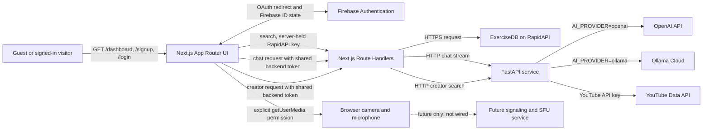

# Fitalert Architecture

## System diagram

## Components and trust boundaries

### Browser / Next.js

- App Router serves the public dashboard and dedicated auth routes.
- Client components manage local UI state, Firebase Auth flows, theme preference, assessment answers, and local camera/microphone preview.
- Firebase web-app config is public. Do not place API secrets in `NEXT_PUBLIC_*`.
- `app/api/exercises` keeps the RapidAPI key server-side, validates/caps query input, applies a basic in-memory request limit, and returns explicit upstream errors.
- `app/api/coach` and `app/api/creators` proxy to Python and attach `FITALERT_BACKEND_TOKEN`; the token is not sent to browsers.

### Firebase Authentication

- Firebase owns email/password credentials, email verification, and federated Google/Microsoft/Apple sign-in.
- The browser uses the Firebase SDK and redirect flow. Firebase provider credentials are configured in Firebase Console.
- The dashboard is not protected: guests can browse. Firebase identity only personalizes the account display and sign-out action.
- There is no Firebase Admin SDK or server-side verification of Firebase ID tokens in the prototype. Add this before building protected APIs or account-specific storage.

### Python AI and creator service

- FastAPI authenticates proxy requests using a shared server-to-server token.
- `AI_PROVIDER` selects the OpenAI or Ollama Python SDK; provider keys remain in Python's environment.
- Responses stream as Server-Sent Events through Next.js to the browser.
- YouTube creator search uses the Data API from the Python service.
- Prompts are external data disclosures: the selected provider receives user chat content. Do not send sensitive medical or identity data.

### External exercise data

- Next.js sends validated, non-cached requests to ExerciseDB through RapidAPI.
- The provider's catalog, image/GIF URLs, availability, usage limits, and license are third-party controlled.

### Media

- `getUserMedia` is called only after the user activates Join; a local video preview is rendered and audio/video tracks can be disabled or stopped.
- No media is currently transmitted or recorded.
- Production multi-user rooms need an authenticated room/session model, signaling service, SFU/media relay, abuse controls, consent UX, and documented retention policy.

## Main data flows

1. **Guest browse:** browser requests `/dashboard`; Next.js renders the dashboard without a session check.
2. **Federated sign-in:** browser creates a Firebase provider and invokes redirect; Firebase returns to the app; `getRedirectResult` resolves and sends the user to `/dashboard`.
3. **Email sign-up:** browser creates the account, updates the display name, requests Firebase verification email, then signs out until the address is verified.
4. **Exercise lookup:** browser calls `/api/exercises`; Next.js validates and requests ExerciseDB with the server-only RapidAPI key.
5. **AI chat:** browser posts messages to `/api/coach`; Next.js authenticates to FastAPI; FastAPI uses exactly the provider selected by `AI_PROVIDER` and streams SSE.
6. **Room preview:** user clicks Join; browser asks for camera/microphone access; tracks are stopped on leave or when navigating away.

## Runtime configuration

See `.env.example` for Firebase public config, RapidAPI, AI provider keys/models, YouTube, and proxy settings. Production secrets must be set in the hosting platform's secret manager. Use HTTPS for deployed Firebase redirects and media capture.

## Prototype constraints and next architecture steps

- Move exercise rate limiting from process memory to a shared store before horizontal scaling.
- Add Firebase Admin verification and per-user authorization before introducing protected data APIs.
- Store assessment and workout plans only after consent, deletion, retention, and access controls are specified.
- Add real-time media infrastructure only after privacy, security, moderation, and capacity reviews.
- Add structured observability, quotas, error budgets, provider cost limits, and resiliency tests for AI and third-party APIs.
